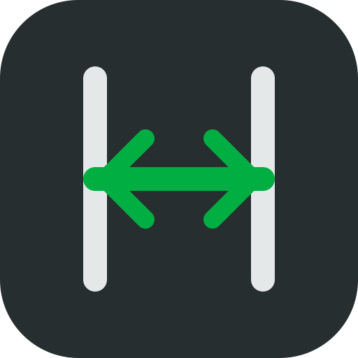
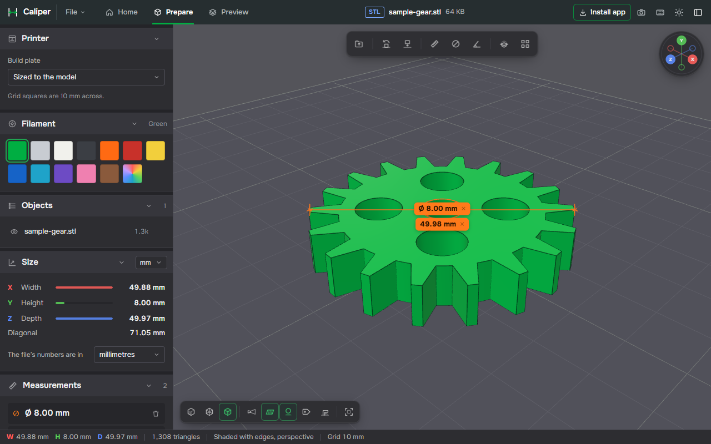
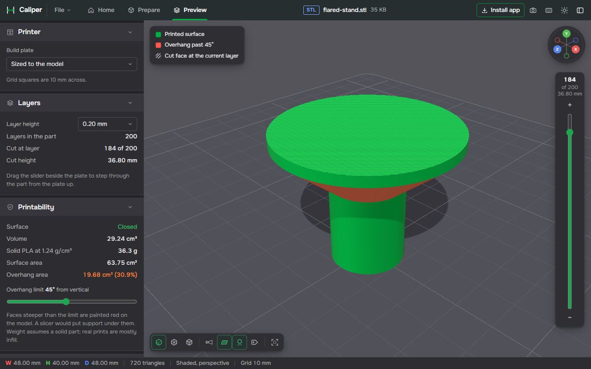
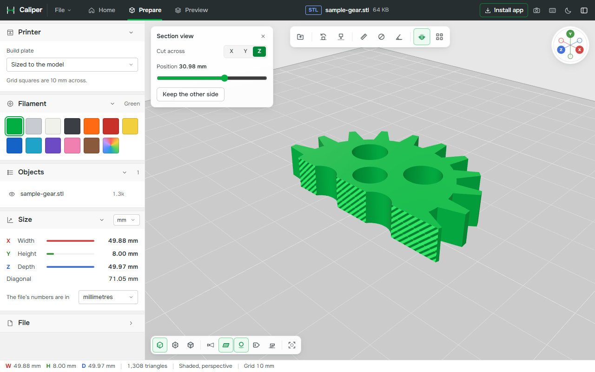
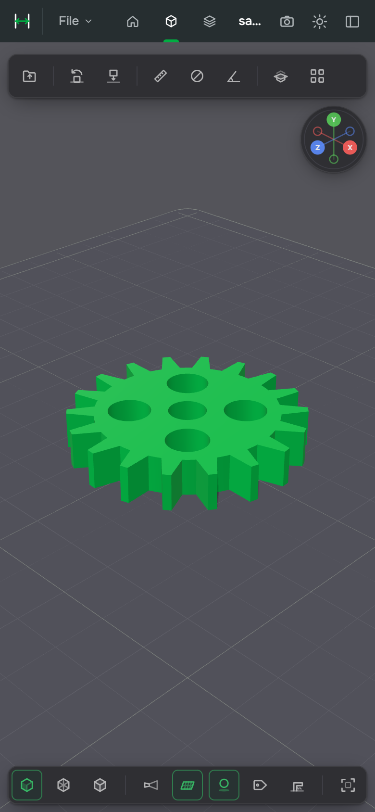
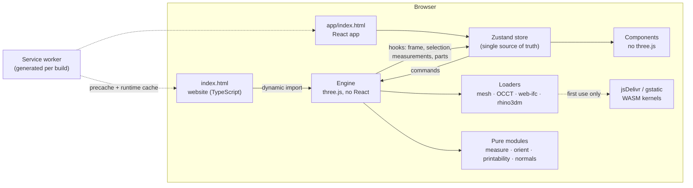

<div align="center">



# Caliper

**Slice and print for the Bambu Lab P1S, in the browser.** Open 22 mesh, CAD and BIM file types, measure and arrange them, then slice with Bambu's own P1S profiles and download a `.gcode.3mf` the printer reads from microSD. Every file is checked for safety before it can be downloaded. Nothing is uploaded.

[](https://github.com/satyaidk/Caliper/actions/workflows/ci.yml)
[](.nvmrc)
[](tsconfig.json)
[](test/)
[](#testing--quality)
[](LICENSE)

[Getting started](#getting-started) · [Design doc](docs/design.md) · [Learning path](docs/learning-path.md) · [ADRs](docs/adr/) · [Changelog](CHANGELOG.md)



</div>

## Overview

Caliper opens a 3D model in a browser tab and answers the questions asked before printing or machining it: how big it is, how big a feature on it is, which way up it should sit, what it looks like inside, and whether it will print without support. Local files stay on the device. Pasting a MakerWorld page fetches only public profile metadata through Caliper's same-origin API; downloading the model remains on MakerWorld and may require a MakerWorld account.

Version 2 rebuilds the interface after Bambu Studio, the slicer most people opening a model already have in another window. The palette is taken from Bambu Studio's source, the workspace is split into the same Home, Prepare and Preview tabs, the sidebar runs Printer, Filament and Objects in the same order, and the keys are the same keys. Caliper ships as two pages: a website at `/` whose hero is the real viewer running on a generated part, and the app at `/app/`, which installs as an offline-capable desktop or phone app.

Caliper is an independent project and is not affiliated with or endorsed by Bambu Lab.

> **Safety.** Caliper's print files are new and have not yet been validated on printer hardware by this project. Supervise your first prints through the nozzle wipe, bed levelling and first layer, and stop the printer if anything looks wrong. See [Slicing and printing](#slicing-and-printing).

## Key features

| Area | What it does |
| --- | --- |
| **Formats** | 22 extensions through three pipelines: mesh (`stl` `obj` `ply` `off` `gltf` `glb` `fbx` `dae` `3ds` `3mf` `amf` `wrl`), CAD B-rep tessellated by WebAssembly kernels (`step` `stp` `iges` `igs` `brep` `brp` `fcstd` `3dm`) and BIM (`ifc` `bim`). |
| **Zip archives** | A `.zip` is unpacked in the browser. One model inside opens directly; several open a chooser to pick one, some or all of them. Textures and materials in the archive come along. |
| **Plate** | Up to 24 models side by side at their true relative sizes, each with its own colour. Drag them with the move tool, nudge them with the arrow keys, type an exact X/Z position, or arrange the whole plate in one key. |
| **Recent models** | Recently opened models, with thumbnails, reopen from this device's storage without choosing the file again, and the last plate comes back where it was left. Clearing site data empties it; a switch turns it off. |
| **Measure** | Distance with an X/Y/Z split, diameter from three points on an arc, and angle from arm, corner, arm. Clicks snap to the nearest corner, edge midpoint or face centre within 14 screen pixels. |
| **Orient** | Lay on face (click a face and it goes down onto the plate) and auto orient (stand the part on its largest flat face on the convex hull). The size readout follows the new orientation. |
| **Look inside** | Section view along X, Y or Z with a hatched, stencil-filled cap so a cut reads as solid; assembly view that pulls parts apart along lines from the centre, ratio 1 to 3. |
| **Slice for the P1S** | Bambu's own P1S 0.4 mm machine, process and filament profiles, fetched at slice time from a pinned Bambu Studio release. Choose filament (Bambu PLA Basic, Bambu PETG Basic, Generic PLA, Generic PETG), build plate, quality (0.16, 0.20 or 0.24 mm), infill, walls, skirt or brim, and grid supports. Slicing runs in a Web Worker. |
| **Pre-flight safety check** | An independent pass re-reads the finished G-code and blocks the download unless every move is on the plate and out of the P1S's excluded corner, Z stays within 250 mm, flow and speeds stay within the filament and printer limits, the bed is levelled over the first layer, and Bambu's start and end sequence is unmodified. |
| **G-code preview** | Open a `.gcode.3mf` or `.gcode` from Bambu Studio, OrcaSlicer, PrusaSlicer or Cura to inspect its toolpaths layer by layer, with its own time and filament figures. |
| **Preview** | Before slicing, a layer slider cuts the part with overhangs painted red. After slicing, the real toolpaths replace the model, coloured by feature, with print time, filament weight and the safety checklist beside them. |
| **Printability** | Closed-surface check (open-edge count), volume, solid-PLA weight, surface area and overhang area, each computed from the triangles. |
| **Printer plates** | Bambu Lab X1/P1/A1 (256 mm), A1 mini (180 mm), Prusa MK4 and Creality Ender-3 beds drawn at true size, with a fit check that allows a quarter turn. |
| **View** | Perspective and orthographic cameras, shaded, wireframe, edges and surface-angle modes (each face coloured by the direction it points, as in GitHub's STL viewer), part labels, an orientation gizmo, Bambu's 0–7 view keys, and PNG export. |
| **Objects** | Per-part visibility, isolate and search, windowed so a 10,000-part IFC model scrolls smoothly; multicolor Bambu/Orca 3MFs also allow per-object AMS assignment and live filament color previews. |
| **App** | Installable PWA with window-controls overlay, OS file handlers, an app shortcut, and offline use from a build-generated service worker. |
| **Themes** | Bambu Studio's dark and light palettes, with every text pair adjusted to clear WCAG AA. |

## Demo

| Prepare | Preview |
| --- | --- |
|  |  |

| Section view, light theme | Phone |
| --- | --- |
|  |  |

Try it without a file: `/app/?sample` opens a generated gear, and `/app/?sample&tab=preview` opens it in the Preview tab.

## Architecture



The split that holds it together: `viewer/` never imports React and `components/` never imports three.js. They meet in the store, which turns every click into an Engine command and every Engine report into state. Analysis code is written against a plain stream of triangles rather than three.js scenes, so the same functions run in the browser and in Node's test runner. The full design, including the scene graph, the section stencil technique and the caching rules, is in [docs/design.md](docs/design.md).

## Getting started

### Prerequisites

- Node.js 22 or newer (`.nvmrc` pins 24)
- A browser with WebGL 2: current Chrome, Edge, Firefox or Safari

### Install

```bash
git clone https://github.com/satyaidk/Caliper.git
cd Caliper
npm install
```

### Configure

There is nothing to configure for local use. Two places to know about before deploying:

| File | What to set |
| --- | --- |
| `index.html`, `app/index.html`, `public/sitemap.xml`, `public/robots.txt` | The production domain in the `canonical` links, the `og:image` URLs and the sitemap. They hold the placeholder `caliper.app` until a domain is chosen. |
| `src/lib/cdn.ts` | Where the CAD and BIM WebAssembly kernels are fetched from. Point these at `public/vendor/` to run with no CDN at all. |

### Run

```bash
npm run dev        # http://localhost:5173 (website) and /app/ (the app)
npm run build      # typecheck, then build both pages and the service worker to dist/
npm run preview    # serve the production build
```

The service worker is only generated and registered in production builds, so `npm run dev` always serves fresh code.

## Usage

Open the app, then drop files, a folder or a `.zip` anywhere in the window, use **File → Open models**, or pass one by URL:

```
https://your-domain/app/?model=https://example.com/bracket.step
https://your-domain/app/?model=/models/bracket.step&name=Bracket.step&tab=preview
```

Only `http` and `https` URLs are followed, and the remote host must send permissive CORS headers. Links to the old root URL (`/?model=…`) are forwarded to `/app/`.

**Several models.** Choose several files at once, or drop them together, and they open side by side on one plate. With models already open, dropping more adds them to the plate; **File → Add models to the plate** (<kbd>Ctrl</kbd> <kbd>I</kbd>) does the same from a dialog, while **Open** (<kbd>Ctrl</kbd> <kbd>O</kbd>) starts a fresh plate. A `.zip` holding several models, or a drop of more than eight, asks which to open. The **Plate** section in the sidebar lists every model: click one to make it active (the Filament, Size, Objects and Printability sections then describe it), click its colour dot to recolour it, and hide or remove it. Clicking a model on the canvas makes it active too.

**Arranging.** Pick up the move tool (<kbd>M</kbd>) and drag any model across the plate; dragging empty space still turns the view. Arrow keys nudge the active model one grid square, the sidebar takes an exact X/Z position, and **Arrange** (<kbd>T</kbd>) packs everything into a tidy block.

**Recent models.** Models you open are kept in this browser's IndexedDB with a thumbnail, and listed on the Home tab. Click one to reopen it, or use **Restore the last plate** to bring back every model where you left it. Nothing is uploaded. Clearing the browser's site data empties the list, and the switch under it turns remembering off and forgets everything already kept.

**Units.** STL and most mesh formats carry no unit, so their numbers are read as millimetres, as a slicer would. glTF is metres by specification and BIM geometry arrives in metres, so those default to metres. The **Size** section's *The file's numbers are in* menu changes it for the file in front of you, and a part under 1 mm across prompts the switch.

### Slicing and printing

1. Open a model and keep the plate on **Bambu Lab X1, P1 and A1 — 256 mm** (the P1S).
2. In **Print settings**, pick the filament, the build plate fitted to the printer, the quality, infill, walls, first-layer adhesion and supports.
3. Select **Slice plate**. The first slice downloads Bambu's profiles from GitHub; later slices reuse the copy stored in the browser.
4. Preview shows the toolpaths, the print time and filament, and the safety checklist. **Download .gcode.3mf** unlocks only when every check passes.
5. Copy the file to the P1S microSD card and start it from the printer screen. Check that the plate on the printer matches the one you chose.

Limits: one filament (external spool, no AMS colour changes), the P1S with a 0.4 mm nozzle, classic walls, grid supports, no ironing.

**Installing.** In Chrome or Edge, use the install button in the top bar or the address bar. Installed, Caliper opens model files from the file manager, keeps working offline, and uses its top bar as the window's title bar. On iPhone and iPad, use Safari's Share menu and *Add to Home Screen*.

### Keyboard

The keys follow Bambu Studio where it has an equivalent. Press <kbd>?</kbd> in the app for the same list.

| Camera | | Tools | | Display | |
| --- | --- | --- | --- | --- | --- |
| <kbd>0</kbd> | Default view | <kbd>R</kbd> | Auto orient | <kbd>Q</kbd> | Shaded |
| <kbd>1</kbd> <kbd>2</kbd> | Top, bottom | <kbd>F</kbd> | Lay on face | <kbd>W</kbd> | Wireframe |
| <kbd>3</kbd> <kbd>4</kbd> | Front, rear | <kbd>U</kbd> | Distance | <kbd>E</kbd> | Shaded with edges |
| <kbd>5</kbd> <kbd>6</kbd> | Left, right | <kbd>D</kbd> | Diameter | <kbd>G</kbd> | Plate |
| <kbd>7</kbd> | Isometric | <kbd>A</kbd> | Angle | <kbd>S</kbd> | Shadows |
| <kbd>Z</kbd> | Fit to view | <kbd>X</kbd> | Section view | <kbd>L</kbd> | Part labels |
| <kbd>K</kbd> | Perspective / orthographic | <kbd>Y</kbd> | Assembly view | <kbd>O</kbd> | Overhangs |
| | | <kbd>Backspace</kbd> | Undo last point | <kbd>Ctrl</kbd> <kbd>O</kbd> / <kbd>S</kbd> | Open, save PNG |
| | | <kbd>Esc</kbd> | Put the tool away | <kbd>Ctrl</kbd> <kbd>B</kbd> / <kbd>J</kbd> | Sidebar, theme |
| | | | | <kbd>N</kbd> | Surface angle |

| Plate | |
| --- | --- |
| <kbd>M</kbd> | Move models: drag them across the plate |
| <kbd>←</kbd> <kbd>→</kbd> <kbd>↑</kbd> <kbd>↓</kbd> | Nudge the active model one grid square, while moving |
| <kbd>T</kbd> | Arrange the plate |
| <kbd>[</kbd> <kbd>]</kbd> | Previous, next model |
| <kbd>Delete</kbd> | Remove the active model |
| <kbd>Ctrl</kbd> <kbd>I</kbd> | Add models to the plate |

## Project structure

```
index.html              the website
app/index.html          the app
src/
  site/                 website script and styles (no React)
  App.tsx, main.tsx     app shell and entry
  components/           React, no three.js: TopBar, Sidebar, Toolbars, Viewport, Home, ...
  store/useViewer.ts    Zustand store, the single source of truth
  viewer/               three.js, no React
    Engine.ts           renderer, the models on the plate, picking, tools
    CameraRig.ts        perspective and orthographic cameras
    Stage.ts            build plate, grid, build volume, lights
    Section.ts          clipping plane and stencil-filled cap
    Explode.ts          assembly view
    materials.ts        filament, wireframe and overhang materials
    measure.ts          snapping, circle fit, angle            (pure)
    orient.ts           resting faces for lay on face           (pure)
    printability.ts     volume, area, open edges, overhang      (pure)
    normals.ts          crease-angle normals for STL            (pure)
    triangles.ts        triangle streams over meshes or arrays  (pure)
    loaders/            one module per pipeline
  components/ModelChooser.tsx  picks models out of a zip or a large drop
  lib/                  formats, units, printers, shortcuts, sample part, labels
    archive.ts          zip reading, filtered before inflating     (pure + fflate)
    intake.ts           models vs companions, when to ask          (pure)
    arrange.ts          shelf packing and placement on the plate   (pure)
    colours.ts          filament palette and per-model colours     (pure)
    recent.ts           recently opened models in IndexedDB
  pwa/                  service worker template and registration
  styles/               tokens.css (palette and type), base.css, app.css
test/                   unit tests, Node's built-in runner
e2e/                    production-config format sweep, run by hand
docs/                   design doc, ADRs, learning path, technical manual
```

## Testing & quality

```bash
npm test             # 298 unit tests
npm run coverage     # the same, with Node's built-in coverage report
npm run typecheck    # tsc --noEmit, strict mode
npm run contrast     # every text colour against every surface, both themes, WCAG AA
```

Unit tests use Node's built-in runner and native TypeScript support, so there is no test framework to install. They pin every piece of maths the app reports as a number: snapping, the circle fit, angles, volume, surface area, open edges, overhang area, resting faces, crease normals, bed fit, layer counts, unit conversion, number formatting and the sample part's dimensions.

Measured on 2026-10-15 with `npm run coverage`: **67.89 %** line coverage across the modules the tests load, and **100 %** line coverage of `measure.ts`, `orient.ts`, `printability.ts`, `normals.ts`, `triangles.ts`, `format.ts` and `labels.ts`. The loaders score low on unit coverage by design; they are exercised by the end-to-end sweep instead.

The end-to-end sweep in [`e2e/`](e2e/) serves `dist/` with the exact headers from `vercel.json`, including the Content-Security-Policy, and opens one real file per format. On 2026-10-15 it reported **19/19 formats rendered**, including every CAD and BIM kernel. See [`e2e/README.md`](e2e/README.md).

`npm run contrast` checks all 60 text-on-surface pairs in `styles/tokens.css` against WCAG AA; Bambu Studio's own muted greys and greens fall short for small text, so those tokens keep Bambu's hue at a lightness that passes.

CI runs typecheck, unit tests, the contrast check and a production build on every push and pull request to `main` and `dev` ([`.github/workflows/ci.yml`](.github/workflows/ci.yml)).

## Evaluation

**Accuracy against shapes with known answers.** Read from the app, compared with values worked out by hand:

| Check | Shape | Expected | Caliper |
| --- | --- | --- | --- |
| Diameter, three clicks on a bore | Sample gear, 8 mm bore (48-sided) | 8.00 mm | 8.00 mm |
| Diameter fitted through three tooth tips | Sample gear, module 2.5, 18 teeth | 50.00 mm | 50.00 mm |
| Volume | Flared stand, 72-sided lathe | 29.24 cm³ | 29.24 cm³ |
| Overhang area past 45° | Flared stand's 49° cone | 19.70 cm² (true cone) | 19.68 cm² (72-sided) |
| Layer count | 40 mm part at 0.20 mm | 200 | 200 |

**Page weight.** From `npm run build` on 2026-10-15, gzip sizes:

| Load | Files | gzip |
| --- | --- | --- |
| Website, before the live hero | HTML, CSS, script | 13.4 kB |
| Website hero, after first paint | Engine, three.js and sample-part chunks | 202.6 kB |
| App, first load | HTML, CSS, React, three.js, Engine, app | 430.3 kB |
| CAD or BIM kernel | WebAssembly, fetched on first use of that format | 5–12 MB each, cached offline after |

## Design decisions

Each decision with lasting consequences has an ADR in [`docs/adr/`](docs/adr/):

| ADR | Decision |
| --- | --- |
| [0001](docs/adr/0001-bambu-studio-interface.md) | Follow Bambu Studio's interface, palette and keys |
| [0002](docs/adr/0002-website-and-app-split.md) | Ship a website at `/` and the app at `/app/` from one build |
| [0003](docs/adr/0003-generated-service-worker.md) | Generate the service worker per build instead of using Workbox |
| [0004](docs/adr/0004-stencil-section-caps.md) | Fill section cuts with a stencil-buffer cap |
| [0005](docs/adr/0005-crease-normals-for-stl.md) | Shade STL files with crease-angle normals |
| [0006](docs/adr/0006-multi-model-plate.md) | Put several models on one plate, with one of them active |
| [0007](docs/adr/0007-slicer-core-layer-planning.md) | Start an independent slicer core with layer planning |
| [0008](docs/adr/0008-p1s-print-files-from-fetched-profiles.md) | Print P1S files built from Bambu's profiles, fetched at slice time |

## Documentation

| Document | For |
| --- | --- |
| [docs/design.md](docs/design.md) | How the app is built and why: scene graph, data flow, rendering, caching, security |
| [docs/learning-path.md](docs/learning-path.md) | A beginner's route through the codebase, in reading order, with exercises |
| [docs/adr/](docs/adr/) | Architecture decision records |
| [docs/Caliper-Technical-Documentation.pdf](docs/Caliper-Technical-Documentation.pdf) | The 84-page manual written for 1.0, still accurate for the loaders, the measuring maths and the deployment chapters |
| [CHANGELOG.md](CHANGELOG.md) | What changed in each release |

## Roadmap

- Validate print files on P1S hardware and against Bambu Studio reference files (see [slicer status](docs/slicer-development-status.md))
- Arachne variable-width walls, tree supports, seam control and ironing
- AMS multi-colour printing and more printers (A1, X1C)
- Open recent files again from the Home tab, using the File System Access API where the browser supports it
- Measure between features — plane to plane, edge to edge — rather than only between picked points
- Complete 3MF paint import for within-face color subdivision in Bambu/Orca projects
- Export the reoriented part as STL or 3MF, ready for the slicer
- Shareable links that carry measurements and the camera
- A desktop build through Tauri for file associations on browsers without the File Handling API
- Regenerate the technical manual for 2.0

## Contributing

Contributions are welcome. Read [CONTRIBUTING.md](CONTRIBUTING.md) for the branch model, the checks a pull request must pass, and the code conventions. Everyone taking part agrees to the [Code of Conduct](CODE_OF_CONDUCT.md).

## Security

Model files never leave the device, and the production Content-Security-Policy limits scripts to this origin and the two CDNs that host the geometry kernels. Slicing fetches Bambu's public printer profiles from `raw.githubusercontent.com` at one pinned release; no model data is sent. To report a vulnerability, follow [SECURITY.md](SECURITY.md); please do not open a public issue.

## License

[MIT](LICENSE).

## Acknowledgements

- [three.js](https://threejs.org/) for rendering and most of the mesh loaders
- [occt-import-js](https://github.com/kovacsv/occt-import-js), built on Open CASCADE Technology, for STEP, IGES, BREP and FCStd
- [web-ifc](https://github.com/ThatOpen/engine_web-ifc) for IFC and [rhino3dm](https://github.com/mcneel/rhino3dm) for 3DM
- [Bambu Studio](https://github.com/bambulab/BambuStudio), whose source is the reference for the palette, layout and keys; no Bambu Studio code or artwork is included
- [Onest](https://fonts.google.com/specimen/Onest), the typeface, under the SIL Open Font License
- [Contributor Covenant](https://www.contributor-covenant.org/), on which the Code of Conduct is based
