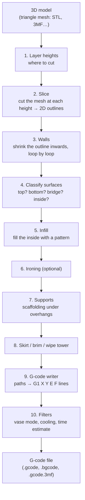
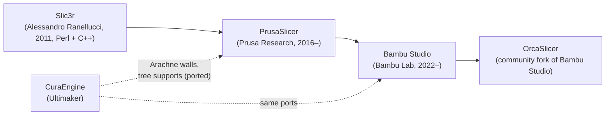
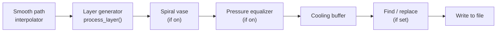

# How PrusaSlicer and Bambu Studio turn a 3D model into G-code

A research report written before Caliper gets a slicer of its own. It explains,
step by step, what the two slicers most people use actually do between "open a
model" and "here is your G-code", using their real source code as the reference.
Nothing in Caliper changes yet; this is the map to build from.

It is written for two readers at once:

- **A beginner engineer** who has never looked inside a slicer. Every term is
  explained the first time it appears, and each step comes with a picture in
  words, the real formula and a worked example with numbers.
- **A coding agent** that will later implement this. Every claim names the file
  and function it comes from, so it can be checked against the source instead
  of trusted.

---

## Contents

1. [How to read this document](#1-how-to-read-this-document)
2. [The big picture in one page](#2-the-big-picture-in-one-page)
3. [Where the two slicers come from](#3-where-the-two-slicers-come-from)
4. [Words you need first](#4-words-you-need-first)
5. [The data model: what the slicer keeps in memory](#5-the-data-model-what-the-slicer-keeps-in-memory)
6. [The pipeline and its steps](#6-the-pipeline-and-its-steps)
7. [Step 1: choosing the layer heights](#7-step-1-choosing-the-layer-heights)
8. [Step 2: cutting the mesh into outlines](#8-step-2-cutting-the-mesh-into-outlines)
9. [Step 3: walls (perimeters)](#9-step-3-walls-perimeters)
10. [Step 4: preparing infill: classifying every surface](#10-step-4-preparing-infill-classifying-every-surface)
11. [Step 5: infill patterns](#11-step-5-infill-patterns)
12. [Step 6: ironing](#12-step-6-ironing)
13. [Step 7: supports](#13-step-7-supports)
14. [Step 8: skirt, brim, wipe tower and tool order](#14-step-8-skirt-brim-wipe-tower-and-tool-order)
15. [The flow maths: how much plastic each line needs](#15-the-flow-maths-how-much-plastic-each-line-needs)
16. [Step 9: writing the G-code](#16-step-9-writing-the-g-code)
17. [Step 10: the post-processing filters](#17-step-10-the-post-processing-filters)
18. [G-code commands you will see](#18-g-code-commands-you-will-see)
19. [What Bambu Studio does differently](#19-what-bambu-studio-does-differently)
20. [What PrusaSlicer does differently](#20-what-prusaslicer-does-differently)
21. [Side-by-side comparison](#21-side-by-side-comparison)
22. [What this means for Caliper](#22-what-this-means-for-caliper)
23. [Glossary](#23-glossary)
24. [Sources and how to check them yourself](#24-sources-and-how-to-check-them-yourself)

---

## 1. How to read this document

**Versions.** Everything here was read from these exact releases. Slicers move
quickly, so if a later version disagrees, the later source wins.

| Slicer | Release read | Where |
| --- | --- | --- |
| PrusaSlicer | `version_2.9.6` (latest stable at the time of writing; `master` is a restructured 3.0 alpha) | `github.com/prusa3d/PrusaSlicer`, folder `src/libslic3r/` |
| Bambu Studio | `v02.08.04.61` | `github.com/bambulab/BambuStudio`, folder `src/libslic3r/` |

**References.** A reference such as `PrintObject.cpp → PrintObject::prepare_infill`
means: the file `src/libslic3r/PrintObject.cpp`, the function
`PrintObject::prepare_infill`. Function names are given instead of line numbers
because line numbers drift between releases.

**Two kinds of statements.** When this report says what the code does, it was
read from the source. When it explains *why*, that is the purpose stated in the
source's comments or, where marked "in practice", general 3D-printing knowledge.

> [!WARNING]
> **Both slicers are licensed under the GNU AGPL v3. Caliper is MIT.** We may
> learn from their code and reimplement the *ideas and maths* in our own code,
> but we must not copy or translate their source into Caliper without changing
> Caliper's licence. Section [22.2](#222-the-licence-question-read-this-before-writing-code)
> explains the options. This is the single most important constraint for the
> implementation work, so read it before writing any code.

---

## 2. The big picture in one page

A 3D printer cannot read a 3D model. It reads **G-code**: a text file of simple
instructions such as "move the nozzle to X=10, Y=20 while pushing out 0.3 mm of
filament". A **slicer** is the program that converts the model into those
instructions.

It does that by cutting the model into thin horizontal slices, like slicing a
loaf of bread, and then deciding, for each slice, exactly where the nozzle
should travel and how much plastic it should squeeze out along the way.



Steps 1–8 are **geometry**: they work on 2D polygons and produce lists of
"extrusion paths" (lines with a width, a height and a role such as "outer
wall"). Steps 9–10 are **G-code generation**: they turn those paths into text,
choosing speeds, temperatures, fan, retractions and travel moves.

Both slicers run this same pipeline. Bambu Studio is a fork of PrusaSlicer, so
the structure, and much of the code, is shared.

---

## 3. Where the two slicers come from



- **Slic3r** started the code base; it was partly written in Perl. Comments
  such as "ported from lib/Slic3r/GCode/CoolingBuffer.pm" still show this.
- **PrusaSlicer** rewrote most of it in C++ and is still where most of the core
  algorithms are developed. Its README says the geometry library is
  `libslic3r`.
- **Bambu Studio** forked PrusaSlicer. Its README says: "Bambu Studio is based
  on PrusaSlicer by Prusa Research, which is from Slic3r." It renamed many
  settings (`perimeters` became `wall_loops`), added features for Bambu
  printers (AMS filament changer, timelapse, printer-side checks) and packs its
  output into a `.gcode.3mf` file.
- Two important algorithms in both come from **CuraEngine** (Ultimaker's
  slicer): *Arachne* variable-width walls and *tree supports*. The source files
  keep Ultimaker's copyright lines.

Because of this history, when you understand one slicer you understand most of
the other. This report describes the shared logic once and then lists the
differences.

---

## 4. Words you need first

These come up on every page. A longer glossary is at the end.

| Word | Meaning |
| --- | --- |
| **Mesh** | The 3D model as a list of triangles. An STL file is exactly this. |
| **Layer** | One horizontal slice of the print, e.g. 0.2 mm thick. |
| **Polygon** | A closed 2D shape made of straight edges, stored as a list of points. |
| **ExPolygon** | "Expanded polygon": one outer polygon (the *contour*) plus zero or more polygons cut out of it (the *holes*). A ring is one ExPolygon with one hole. |
| **Offset** | Moving every edge of a polygon outwards (positive) or inwards (negative) by a distance. Shrinking an outline by half a line width gives the centre line of the outer wall. |
| **Boolean operations** | Union (combine), difference (subtract), intersection (overlap) of polygons. The slicer uses them constantly. Both slicers use the **Clipper** library for this. |
| **Perimeter / wall** | A loop of plastic that follows the outline of the part. The outermost one is the *external perimeter*. |
| **Infill** | The pattern that fills the inside of the part. *Sparse* infill (e.g. 15%) is mostly air; *solid* infill (100%) is used for top and bottom skins. |
| **Shell** | The solid outside of the part: the walls plus the solid top and bottom layers. |
| **Bridge** | A line printed in mid-air between two supported points. |
| **Overhang** | Part of a layer that sticks out past the layer below it. |
| **Extrusion** | Pushing filament through the hot nozzle. In G-code it is the `E` value. |
| **Travel** | Moving the nozzle without extruding. |
| **Retraction** | Pulling the filament back a little before a travel so it does not ooze (drip) and leave strings. |
| **Flow** | How much plastic comes out per millimetre of movement, in mm³/mm. |
| **Feed rate** | Movement speed. In G-code, `F` is in **mm per minute**, not per second. |

---

## 5. The data model: what the slicer keeps in memory

Before the steps make sense you need to know what objects they read and write.
The names below are the real C++ class names, identical in both slicers unless
noted.

### 5.1 Input side: the model

```text
Model                      everything on the plate
└── ModelObject            one object the user sees in the object list
    ├── ModelVolume        one mesh inside it (a part, a modifier, a negative volume…)
    │   └── TriangleMesh   the triangles
    └── ModelInstance      one copy of the object on the plate (position, rotation, scale)
```

An object can have several **volumes**: the main part, a *modifier* (a shape
that changes settings inside it, e.g. more infill in one area), a *negative
volume* (a shape subtracted from the part) or a *support blocker/enforcer*. An
object can also have several **instances**, which are copies sliced once and
printed several times.

### 5.2 Processing side: the print

```text
Print                      the whole slicing job and its config
├── PrintObject            one ModelObject being sliced (shared by its instances)
│   ├── Layer[]            one per layer height
│   │   └── LayerRegion[]  the part of this layer that uses one set of settings
│   │       ├── slices          ExPolygons: the cut outline, typed (top, bottom…)
│   │       ├── fill_surfaces   what is left for infill after the walls
│   │       ├── perimeters      the wall extrusion paths
│   │       └── fills           the infill extrusion paths
│   └── SupportLayer[]     support material, its own layers
└── PrintRegion[]          one per distinct set of region settings
```

A **region** is "the area of a layer that shares one set of settings". With no
modifiers, every layer has one region. A modifier that sets 50% infill creates a
second region for the area it covers.

### 5.3 Surface types

Every piece of a layer gets a **type**. This is how the slicer remembers "this
part is a top surface" or "this part is mid-air". From `Surface.hpp → enum
SurfaceType` (PrusaSlicer):

| Type | Meaning |
| --- | --- |
| `stTop` | Seen from above. Printed solid and neat. |
| `stBottom` | Seen from below, resting on something. Printed solid. |
| `stBottomBridge` | Seen from below, resting on nothing: an overhang, printed with bridge flow. |
| `stInternal` | Inside the part. Gets sparse infill. |
| `stInternalSolid` | Inside, but must be solid (it supports a top surface or keeps a wall thick enough). |
| `stInternalBridge` | First solid layer printed over sparse infill: it bridges across the gaps in the infill. |
| `stInternalVoid` | Inside, deliberately left empty (e.g. combined infill layers). |
| `stPerimeter` | Taken by walls. |
| `stSolidOverBridge` | Internal solid directly above a bottom bridge (newer PrusaSlicer). |

### 5.4 Extrusion paths and roles

The geometry steps end with **extrusion entities**: a polyline (list of points)
plus `width`, `height`, `mm3_per_mm` (flow) and a **role**. The role tells the
G-code writer which speed, acceleration and fan rules apply. Roles include
external perimeter, perimeter, overhang perimeter, internal infill, solid
infill, top solid infill, bridge infill, gap fill, ironing, skirt, support
material, support interface and wipe tower.

### 5.5 Coordinates are integers

Floating-point numbers make polygon booleans unreliable, so both slicers store
2D coordinates as **64-bit integers** and scale millimetres up:

| Slicer | `SCALING_FACTOR` (`libslic3r.h`) | 1 integer unit = |
| --- | --- | --- |
| PrusaSlicer | `0.000001` | 1 nanometre (10⁻⁶ mm) |
| Bambu Studio | `0.00001` | 10 nanometres (10⁻⁵ mm) |

`scale_(mm) = mm / SCALING_FACTOR` and `unscale(units) = units * SCALING_FACTOR`.
So in PrusaSlicer, 0.4 mm is stored as `400000`.

Both slicers are **Z-up**: X to the right, Y away from you, Z up, with the
origin at the front-left corner of the bed in the final G-code.

---

## 6. The pipeline and its steps

### 6.1 The step lists

The pipeline is split into named steps. From `Print.hpp`:

**Per object** (`enum PrintObjectStep`):

| PrusaSlicer 2.9.6 | Bambu Studio 02.08.04.61 |
| --- | --- |
| `posSlice` | `posSlice` |
| `posPerimeters` | `posPerimeters` |
| `posPrepareInfill` | `posPrepareInfill` |
| `posInfill` | `posInfill` |
| `posIroning` | `posIroning` |
| `posSupportSpotsSearch` | — |
| `posSupportMaterial` | `posSupportMaterial` |
| `posEstimateCurledExtrusions` | — |
| `posCalculateOverhangingPerimeters` | — |
| — | `posDetectOverhangsForLift` |
| — | `posSimplifyWall`, `posSimplifyInfill`, `posSimplifySupportPath` |

**Whole print** (`enum PrintStep`): `psWipeTower` (also called
`psToolOrdering`), `psSkirtBrim`, `psGCodeExport`. PrusaSlicer adds
`psAlertWhenSupportsNeeded`; Bambu Studio adds `psConflictCheck`.

### 6.2 Why it is split into steps: invalidation

Each step records whether it has started and finished (`set_started` /
`set_done`). When you change a setting, the slicer only throws away the steps
that depend on it. Change the infill density and the walls are kept; change the
layer height and everything from `posSlice` on is redone. Each step also
**calls the step before it first**: `make_perimeters()` begins with
`this->slice()`, `infill()` begins with `this->prepare_infill()`. That makes the
steps safe to call in any order.

### 6.3 The order, as `Print::process` runs it

PrusaSlicer (`Print.cpp → Print::process`), simplified:

```text
for each object, in parallel:
    make_perimeters()        # runs slice() first if needed
    infill()                 # runs prepare_infill() first if needed
    ironing()
for each object, one at a time:
    generate_support_spots() # finds spots that may need support, to warn the user
alert_when_supports_needed()
for each object, in parallel:
    generate_support_material()
    estimate_curled_extrusions()
    calculate_overhanging_perimeters()
make wipe tower, or just the tool ordering
make skirt and brim
check for collisions between objects' paths
```

The G-code export (`psGCodeExport`) runs afterwards, from
`GCode.cpp → GCodeGenerator::do_export`.

Bambu Studio (`Print.cpp → Print::process`) has the same order with three
additions:

1. **Shared objects.** Before slicing it compares objects (same mesh, same
   transform, same settings, same painting). Identical objects are sliced once
   and the result is copied (`set_shared_object`,
   `copy_layers_from_shared_object`). Ten identical parts slice as fast as one.
2. `detect_overhangs_for_lift()` runs after supports, so later travel moves can
   lift over overhangs.
3. Before the wipe tower it estimates print time per filament and checks which
   filaments a nozzle cannot physically reach (for multi-nozzle printers).

**Parallelism.** Both use Intel TBB (`tbb::parallel_for`) to process objects,
and inside a step usually layers, on all CPU cores. A step that needs the layer
below or above (for example classifying top surfaces) still runs in parallel,
because it only *reads* neighbouring layers that the previous step already
finished.

---

## 7. Step 1: choosing the layer heights

### 7.1 What it does

Before cutting, the slicer decides where every layer starts and ends. The result
is a list of pairs `[bottom, top]`, one per layer.

### 7.2 The inputs

- `first_layer_height` (Bambu: `initial_layer_print_height`), e.g. 0.2 mm.
- `layer_height`, e.g. 0.2 mm.
- A **layer height profile**: a list of `(z, height)` pairs. With a fixed layer
  height it is just `[0, h, object_height, h]`. With *variable layer height*
  (the user painted it, or the adaptive algorithm in `SlicingAdaptive.cpp`
  chose it from the surface slope) it has many points.
- `min_layer_height` and `max_layer_height` from the printer. In PrusaSlicer, if
  the printer leaves them at 0, the minimum is `0.07` mm
  (`Slicing.cpp → MIN_LAYER_HEIGHT_DEFAULT`) and the maximum is
  `0.75 × nozzle diameter`.

### 7.3 The algorithm

From `Slicing.cpp → generate_object_layers` (the two slicers match):

```text
out = []
print_z = 0
if the first layer has a fixed height:
    out += [0, first_layer_height]
    print_z = first_layer_height

loop:
    slice_z = print_z + min_layer_height / 2
    if slice_z >= object_height: stop
    height = look up the profile at slice_z,
             interpolating linearly between its two nearest points
    slice_z = print_z + height / 2
    if slice_z >= object_height: stop
    out += [print_z, print_z + height]
    print_z += height
```

Then `PrintObjectSlice.cpp → new_layers` creates one `Layer` per pair, with:

- `print_z` = the top of the layer (where the nozzle will be),
- `height` = top − bottom,
- **`slice_z` = the middle of the layer: `(bottom + top) / 2`.**

> **Why cut in the middle?** A layer of plastic stands for the whole slab
> between its bottom and its top. Cutting at the middle gives the average
> outline of that slab, so a sloped wall is wrong by at most half a layer
> instead of a whole one.

### 7.4 Worked example

A 1.0 mm tall part, first layer 0.2 mm, layer height 0.2 mm, minimum 0.07 mm:

| Layer | Bottom | Top (`print_z`) | Cut at (`slice_z`) |
| --- | --- | --- | --- |
| 0 | 0.0 | 0.2 | 0.1 |
| 1 | 0.2 | 0.4 | 0.3 |
| 2 | 0.4 | 0.6 | 0.5 |
| 3 | 0.6 | 0.8 | 0.7 |
| 4 | 0.8 | 1.0 | 0.9 |

After layer 4, `print_z` = 1.0, so the next `slice_z` would be 1.035, which is
not below the object height of 1.0, so the loop stops. Five layers.

Note the source's own comment: `//FIXME Adjust the last layer to align with the top
object layer exactly?`. If the height is not a multiple of the layer height,
the top of the print can end slightly below or above the model's top.

---

## 8. Step 2: cutting the mesh into outlines

### 8.1 What it does

For every layer's `slice_z`, intersect the triangle mesh with a horizontal plane
and get back the closed 2D outlines (ExPolygons) of the part at that height.
This is `PrintObject::slice` → `PrintObject::slice_volumes`, which calls
`TriangleMeshSlicer.cpp → slice_mesh_ex`.

### 8.2 Cutting one triangle

`TriangleMeshSlicer.cpp → slice_facet` handles one triangle and one plane:

- If all three corners are above or all below the plane, the triangle is not
  cut.
- Otherwise the plane crosses two of its edges. On each crossed edge between
  corners `a` and `b`, the crossing point is found by linear interpolation:

  ```text
  t = (slice_z - a.z) / (b.z - a.z)
  point = a + t × (b - a)
  ```

- The two points form one **line segment** of the outline.
- The corners are reordered so the segment always has the same direction
  relative to the triangle's outward normal ("external on the right"). This
  keeps outer contours counter-clockwise and holes clockwise, which is how the
  slicer later tells a hole from a solid.
- Each segment remembers *which mesh edge or vertex* each end lies on. That is
  what makes the next step fast and exact.

Special cases decided in the source comments:

- A plane passing exactly through a corner is a "touch", not a cut.
- A horizontal triangle lying exactly in the plane: "an upward facing
  horizontal face is considered on slicing plane, while a downward facing
  horizontal face is considered not on slicing plane"
  (`TriangleMeshSlicer.hpp`).

### 8.3 Joining segments into loops

The segments of one layer are joined end to end into closed loops
(`make_loops`):

1. **By connectivity** (`chain_lines_by_triangle_connectivity`). Two segments
   that share a mesh edge are neighbours, so they are chained without comparing
   coordinates at all. On a clean, closed ("manifold") mesh this closes every
   loop.
2. **Exact end points** (`chain_open_polylines_exact`). Leftover open chains are
   joined where their ends coincide, first in the same direction, then allowing
   reversed ones.
3. **Closing gaps** (`chain_open_polylines_close_gaps`). On a broken mesh, ends
   that are close but not equal are joined, longest chains first.

> **Why this matters for Caliper.** Caliper already reports a model's "open
> edges" (`src/viewer/printability.ts → openEdges`). Open edges are exactly what
> breaks step 1 and forces the slicer into the gap-closing step. A model that
> fails Caliper's closed-surface check may slice with missing or odd layers.

### 8.4 From loops to ExPolygons

`make_expolygons` turns the loops into ExPolygons using Clipper:

- **Fill rule.** The default mode `Regular` uses Clipper's *non-zero* rule:
  a point is inside if the loops around it wind around it a non-zero number of
  times. Overlapping shells in a sloppy model are merged instead of cancelling
  out. An `EvenOdd` mode exists for models that rely on it; `Positive` and
  `PositiveLargestContour` (used by vase mode) force all loops to count as
  solid (`MeshSlicingParams::SlicingMode`).
- **Closing radius** (`slice_closing_radius`). A tiny *morphological closing*
  (grow, then shrink by the same amount) fills hairline cracks.
- **Resolution** (`resolution`). Points closer together than this are merged,
  so a finely tessellated mesh does not produce millions of tiny segments.

### 8.5 Regions, painting and size compensation

After cutting, `slice_volumes` continues:

1. **Split into regions** (`slices_to_regions`). Modifier volumes and layer
   range settings decide which part of each layer belongs to which
   `PrintRegion`. Negative volumes are subtracted.
2. **Remove empty top layers.**
3. **Multi-material painting** (`apply_mm_segmentation`): faces the user painted
   with a different filament become their own regions. **Fuzzy skin painting**
   is handled the same way.
4. **XY size compensation** (`xy_size_compensation`): grow or shrink every
   outline by a fixed amount, to correct a printer that prints holes too small
   or parts too big. Positive values are applied while cutting, negative values
   here.
5. **Elephant foot compensation** (`elefant_foot_compensation`, spelled that
   way in the code): only on layer 0 and only when printing directly on the bed
   (no raft). The first layer is squashed and spreads outwards, so its outline
   is shrunk to compensate. `ElephantFootCompensation.cpp` shrinks it
   carefully, so narrow parts of the outline are not lost.
6. **`Layer::make_slices`** merges the regions into `lslices`, the islands of the
   whole layer, and orders them by a shortest path.

---

## 9. Step 3: walls (perimeters)

### 9.1 What it does

For each layer and region, turn the outline into nested loops of plastic, from
the outside inwards, and work out what area is left for infill. This is
`PrintObject::make_perimeters` → `Layer::make_perimeters` →
`PerimeterGenerator.cpp`.

### 9.2 Extra perimeters on domed tops

Before generating walls, `PrintObject::make_perimeters` checks each layer
against the one above. If the upper layer's outline falls into a narrow band
just inside this layer's walls (the "critical area", 1.5 × perimeter spacing
deep) along more than **30%** of its length, this layer gets one more wall, and
the test repeats. This is for the top of a dome, where each layer is slightly
smaller than the last and its wall would otherwise land on sparse infill.
It is controlled by `extra_perimeters` and is skipped when there is no infill.

### 9.3 Classic walls

`PerimeterGenerator::process_classic` is the original Slic3r method:

```text
outline = this layer's outline
loop i = 0 .. wall_count-1:
    if i == 0:
        offset by −(external_width / 2)            # centre line of the outer wall
    else:
        offset by −(previous spacing / 2 + spacing / 2)
    if nothing is left: stop
    store the result as wall i
inner edge of the last wall → area left for infill
narrow leftovers between walls → "gap fill" (thin single lines)
parts too thin for even one wall → "thin walls" (if enabled)
```

Every wall has the **same width**. If a part is 1.0 mm thick and each wall is
0.45 mm, two walls fit and a thin sliver is left over, which is either filled
by a thin gap fill line or left empty.

### 9.4 Arachne walls (variable width)

`PerimeterGenerator::process_arachne` uses the `Arachne/` folder, ported from
CuraEngine (`Arachne/WallToolPaths.hpp` keeps the Ultimaker copyright).

Instead of fixed-width offsets, Arachne computes the **medial axis** of the
outline (the line through the middle of every thin feature, via a Voronoi
diagram, a "skeletal trapezoidation") and then decides how many lines fit at
each point and how wide each must be. Where a wall narrows, lines get thinner
or merge; where it widens, a line is added. The result has fewer gaps and
fewer tiny gap-fill lines, especially in text, thin ribs and sharp corners.

It is the C++ default in both (`perimeter_generator` / `wall_generator` =
`Arachne`). The shipped profiles differ: PrusaSlicer's MK4S profiles use
`arachne`, while Bambu Studio's base profile (`fdm_process_common.json`) sets
`wall_generator = classic`.

### 9.5 Wall order

Both can print outer-then-inner or inner-then-outer.

- Inner first (the default in both) gives the outer wall something to press
  against, which looks better and handles overhangs better.
- Outer first gives more accurate outer dimensions.

PrusaSlicer: `external_perimeters_first` (default off). Bambu Studio:
`wall_sequence` with `InnerOuter` (default), `OuterInner` and
`InnerOuterInner` (outer wall printed between two inner ones).

### 9.6 The seam

A wall is a closed loop, so it must start and end somewhere. That point leaves
a small mark: the **seam**. Both have `seam_position`:

| Option | Behaviour |
| --- | --- |
| Aligned (default in both) | Seams line up vertically, preferring hidden concave corners. |
| Nearest | Start wherever is closest to the nozzle. Fast, scattered seams. |
| Rear | Put the seam at the back of the part. |
| Random | Scatter seams to avoid a visible line. |

PrusaSlicer 2.9 rewrote the seam placer into several files
(`GCode/SeamPlacer.cpp`, `SeamAligned.cpp`, `SeamRear.cpp`, `SeamRandom.cpp`,
`SeamScarf.cpp`, …). Bambu Studio keeps the earlier single `SeamPlacer.cpp`.
Both support **scarf seams**: the loop's start and end ramp up and down in Z
and flow so they overlap smoothly instead of butting together.

---

## 10. Step 4: preparing infill: classifying every surface

This is the step that decides "solid here, sparse there, bridge there". It is
`PrintObject::prepare_infill`, and it runs these sub-steps in this order.

### 10.1 `detect_surfaces_type`: top, bottom or inside?

For every layer, compare its outline with the layers directly above and below
(PrusaSlicer, `PrintObject::detect_surfaces_type`):

```text
top    = this layer − layer above      (what nothing covers)
bottom = this layer − layer below      (what nothing holds up)
inside = everything else
```

`−` is a polygon difference. Each result is cleaned with a small *opening*
(shrink then grow by 1/10 of the external perimeter width) to delete slivers
too thin to matter.

The top layer of the object is all `stTop`. Bottom areas become `stBottomBridge`
(an overhang, bridged in mid-air) unless the layer is printed on soluble support
touching the part (`support_material_contact_distance = 0`), in which case it is
`stBottom`.

Picture a mug: the bottom disc is `stBottom` on layer 0. The inside of the
mug's floor is `stTop` on the last floor layer, because nothing is printed above
it. The handle's underside where it leaves the body is `stBottomBridge`.

### 10.2 `prepare_fill_surfaces`

Turns top/bottom into plain internal if the user set zero top or bottom layers,
and turns tiny internal areas into solid ones, where sparse infill would be a
few pointless strokes.

### 10.3 `discover_vertical_shells`: keep the walls thick on slopes

On a gentle slope, each layer's walls sit mostly on the infill below, so the
shell would be thin. This step adds solid infill next to sloped walls so the
shell keeps the thickness the top/bottom layer counts promise. In PrusaSlicer it
follows `ensure_vertical_shell_thickness`.

### 10.4 `process_external_surfaces`: bridges

From the source comments:

1. Bottom and bottom-bridge areas are grown by 3 mm into the infill area, so a
   bridge is anchored into solid material on both sides. **Bridge direction**
   is chosen here (`BridgeDetector.cpp`): the direction in which the lines are
   best supported at both ends.
2. Top areas are grown by 3 mm the same way.
3. Internal areas are clipped by the grown areas.
4. Surfaces of the same kind are merged.

### 10.5 `discover_horizontal_shells`: top and bottom skins

A single layer marked `stTop` is not enough; the user asked for, say, 5 top
layers. This step walks *down* from every top surface for
`top_solid_layers − 1` layers (Bambu: `top_shell_layers`) and *up* from every
bottom surface for `bottom_solid_layers − 1` layers, marking those areas
`stInternalSolid`. Both slicers also have a minimum shell *thickness* option
(`top_solid_min_thickness` / `top_shell_thickness`), which adds layers when the
layers are very thin.

### 10.6 `bridge_over_infill`

The first solid layer above sparse infill would sag into the infill's gaps. This
step finds those areas and makes them `stInternalBridge`: printed with bridge
flow and speed, in a direction chosen to cross the infill lines.

### 10.7 `combine_infill`

If `infill_every_layers` is N > 1, N layers of sparse infill are printed as one
thicker layer, every N-th layer, and the others become `stInternalVoid`. This
saves time when the nozzle can lay down thicker lines.

### 10.8 Infill above bridges (PrusaSlicer)

Areas of solid infill directly above bridges are split off
(`InfillAboveBridges.cpp → separate_infill_above_bridges`) so they can use
`over_bridge_speed`.

---

## 11. Step 5: infill patterns

`PrintObject::infill` → `Layer::make_fills` (`Fill/Fill.cpp`).

### 11.1 Grouping

`group_fills` collects all fill surfaces of a layer that share the same pattern,
density, angle, flow and bridge state, so each group is filled in one go.
Top surfaces get the top pattern, bottoms the bottom pattern, internal solid
the solid pattern and internal sparse the sparse pattern.

### 11.2 Line spacing from density

For line-based patterns (`Fill/FillRectilinear.cpp`):

```text
line_spacing = spacing / density
```

`spacing` is the flow's centre-to-centre distance (section 15). At 100% the
lines touch; at 20%, `0.45 / 0.20 ≈ 2.25 mm` apart, roughly.

### 11.3 Angle

`fill_angle` (Bambu: `infill_direction`) defaults to **45°**. The base class
rotates every other layer by 90° (`FillBase.hpp → _layer_angle` returns 0 or
π/2 depending on the layer index), so consecutive layers cross. Bridges ignore
this and use the direction found by the bridge detector.

### 11.4 The patterns

PrusaSlicer 2.9.6 (`enum InfillPattern`): rectilinear, monotonic, monotonic
lines, aligned rectilinear, grid, triangles, stars, cubic, line, concentric,
honeycomb, 3D honeycomb, gyroid, Hilbert curve, Archimedean chords, octagram
spiral, adaptive cubic, support cubic, support base, lightning, ensuring,
zig-zag.

Bambu Studio adds: cross hatch, cross zag, locked zag, floating concentric,
2D lattice, an internal concentric, an Archimedean-spiral ironing pattern and a
global monotonic line.

What the important ones are:

| Pattern | Idea | Typical use |
| --- | --- | --- |
| Rectilinear | Parallel lines, alternating 90° per layer. | Solid layers. |
| Monotonic | Rectilinear, but every line is printed in the same direction, side to side. No visible "stitch" lines on top. | Top surfaces. |
| Grid | Lines in two directions on every layer. | Fast sparse infill (Bambu and Prusa profiles both ship it). |
| Cubic / adaptive cubic | Lines that form 3D cubes standing on a corner; adaptive cubic makes the cubes bigger deep inside the part, where strength matters less. | Strong sparse infill / saving material. |
| Gyroid | A smooth wavy 3D surface; equally strong in all directions. | Strong sparse infill. |
| Lightning | Tree-like infill that only supports the top surfaces. | Fast, weak parts. |
| Concentric | Rings following the outline. | Flexible parts, round tops. |

Patterns such as gyroid and cubic are **3D**: the 2D lines on a layer depend on
the layer's Z, so the layers stack into a 3D structure.

### 11.5 Anchors

Infill lines end at the inner wall. "Anchoring" (`infill_anchor` /
`sparse_infill_anchor`) connects line ends along the wall so lines are fastened
instead of left dangling. Bambu's default is `400%` of the line width.

---

## 12. Step 6: ironing

Optional (`ironing` / `ironing_type`). After a top surface is printed, the nozzle
passes over it again with a very small flow, melting and smoothing it. Choices:
top surfaces, only the topmost surface, or all solid surfaces.
Implemented in `PrintObject::ironing` / `Layer::make_ironing`.

---

## 13. Step 7: supports

### 13.1 Finding what needs support

An overhang needs support if it sticks out too far past the layer below.

PrusaSlicer (`Support/SupportMaterial.cpp`, function computing the overhangs):

```text
if support_material_threshold == 0 (automatic):
    allowed overhang = 0.5 × external perimeter width
else:
    allowed overhang = layer height / tan(threshold angle + 1°)
needs support = this layer − (layer below grown by allowed overhang)
```

The threshold angle is measured **from the horizontal** (PrusaSlicer's tooltip:
"90° = vertical"). A 45° threshold allows each layer to step out by one layer
height.

Bambu Studio uses `support_threshold_angle`, default **30°**, also from the
horizontal: "Support will be generated for overhangs whose slope angle is below
the threshold."

> **Caliper note.** Caliper's overhang highlight (`src/viewer/printability.ts`)
> measures the limit **from vertical**, like Bambu Studio's
> "overhang threshold" in its *Preview*. Converting between the two:
> `from_vertical = 90° − from_horizontal`.

### 13.2 Styles

| PrusaSlicer `support_material_style` | Bambu Studio `support_type` + `support_style` |
| --- | --- |
| `grid` (default), `snug`, `organic` (and `tree`, internally) | type: `normal(auto)` (default), `tree(auto)`, `normal(manual)`, `tree(manual)`; style: default, grid, snug, tree slim, tree strong, tree hybrid, organic |

- **Normal / grid supports** project the overhang straight down to the bed or
  the part and fill the column with a sparse pattern.
- **Snug** follows the part's outline more closely.
- **Tree / organic supports** grow branches that start at a few points on the
  bed and split as they rise, only touching the part where needed. Both
  slicers' organic supports are Thomas Rahm's tree supports, "loosely based on
  Tree Supports by CuraEngine" (`TreeSupport.cpp`, Bambu's `TreeSupport3D.cpp`).
  Bambu also has its own older tree support (`TreeSupport.cpp`) for the slim,
  strong and hybrid styles.

### 13.3 Interfaces and gaps

- **Contact (Z) distance** (`support_material_contact_distance`, default 0.2 mm;
  Bambu `top_z_distance`): the air gap between the support's top and the part,
  so the support breaks away.
- **Interface layers**: denser layers at the top of the support, giving the
  part a flatter surface to rest on.
- **Raft**: a few layers printed under the whole part.
- Support **enforcers** and **blockers** (painted, or modifier volumes) force or
  forbid support in an area.

---

## 14. Step 8: skirt, brim, wipe tower and tool order

- **Skirt**: one or more loops around the parts, not touching them, to prime the
  nozzle. With a *draft shield* the skirt is printed all the way up as a wall.
- **Brim**: loops attached to the first layer of the part, to stop corners
  lifting. Bambu Studio also has *brim ears*: small brim patches only at sharp
  corners.
- **Tool ordering** (`GCode/ToolOrdering.cpp`): for multi-material prints,
  decides which filaments are used on each layer and in which order, to
  minimise filament changes.
- **Wipe tower / prime tower** (`GCode/WipeTower.cpp`): a tower beside the parts
  where the old filament is purged after each change. How much is purged
  depends on the pair of colours: PrusaSlicer's `wiping_volumes_matrix`, Bambu
  Studio's `flush_volumes_matrix` (dark-to-light needs more purging than
  light-to-dark).

---

## 15. The flow maths: how much plastic each line needs

This is the heart of "G-code conversion". If you remember one section, make it
this one.

### 15.1 The shape of an extruded line

A line of molten plastic squashed onto the layer below is not a rectangle. Both
slicers model it as a **rectangle with semicircles on both sides** ("rounded
rectangle"), `width` wide and `height` tall:

```text
      ╭───────────────╮
     (                 )   height h
      ╰───────────────╯
      |←───── w ─────→|
```

### 15.2 The formulas

From `Flow.cpp` (identical in both slicers):

```text
cross_section_area (mm²)  = h × (w − h × (1 − π/4))         # mm3_per_mm()
spacing (mm)              = w − h × (1 − π/4)               # centre-to-centre distance
bridge area (mm²)         = π × w² / 4                      # a round thread in mid-air
bridge spacing (mm)       = w + 0.05                        # BRIDGE_EXTRA_SPACING
```

`1 − π/4 ≈ 0.2146`. The rounded sides of neighbouring lines overlap a little,
which is why lines are placed `spacing` apart rather than `width` apart.

**Default widths** if the user leaves a width at 0
(`Flow.cpp → auto_extrusion_width`):

| Role | Width |
| --- | --- |
| Support, support interface, top solid infill | 1.0 × nozzle diameter |
| Everything else (walls, infill, solid infill) | 1.125 × nozzle diameter |

For a 0.4 mm nozzle that is 0.4 mm and 0.45 mm. In practice the shipped
profiles set explicit widths: PrusaSlicer's MK4S profile uses 0.45 mm (0.42 mm
for top infill); Bambu's base profile uses 0.42 mm for the outer wall and top
surface and 0.45 mm for inner walls and sparse infill.

### 15.3 From volume to filament length: the E value

The printer does not know about volume; it moves the filament by a length `E`.
From `Extruder.cpp` and `GCode.cpp`:

```text
filament_area   = π × (filament_diameter / 2)²
e_per_mm3       = flow_multiplier / filament_area
e_per_mm        = e_per_mm3 × cross_section_area
E for a segment = e_per_mm × segment_length
```

- `flow_multiplier` is `extrusion_multiplier` in PrusaSlicer and
  `filament_flow_ratio` in Bambu Studio. It corrects for a filament that comes
  out slightly over or under.
- PrusaSlicer has `use_volumetric_e`: if on, it does **not** divide by the
  filament area and writes E in mm³ (some firmware wants that). Bambu Studio
  always divides.

### 15.4 Worked example

A 0.4 mm nozzle, 1.75 mm filament, flow multiplier 1.0, a 0.2 mm layer, a
0.45 mm wide wall line, 10 mm long:

```text
cross_section = 0.2 × (0.45 − 0.2 × 0.2146)
              = 0.2 × (0.45 − 0.04292)
              = 0.2 × 0.40708
              = 0.081416 mm²         (= mm³ of plastic per mm of line)

filament_area = π × 0.875² = 2.40528 mm²

e_per_mm      = 0.081416 / 2.40528 = 0.033849

E for 10 mm   = 0.33849 mm of filament
```

So the G-code line is roughly `G1 X… Y… E0.33849` (relative E) and the line
is spaced `0.45 − 0.04292 = 0.40708 mm` from its neighbour.

> The number `2.40528` appears in Bambu's own printer G-code templates as
> `2.4053`: they divide a volumetric speed (mm³/s) by it to get a filament feed
> rate (mm/s). Now you know where it comes from.

### 15.5 The volumetric speed cap

A hot end can only melt so much plastic per second. The slicer therefore caps
speed:

```text
max_speed = max_volumetric_speed / cross_section_area
speed     = min(requested_speed, max_speed)
```

With a 15 mm³/s limit and the 0.081416 mm² line above, the cap is
`15 / 0.081416 ≈ 184 mm/s`. Ask for 250 mm/s and you get 184. In PrusaSlicer
this happens in `cap_speed` inside `GCodeGenerator::_extrude`, "even if user is
not using autospeed". If a role's speed is set to 0, PrusaSlicer uses the
volumetric limit itself as the speed (`m_volumetric_speed / mm3_per_mm`).

---

## 16. Step 9: writing the G-code

### 16.1 The file, top to bottom

PrusaSlicer, `GCode.cpp → GCodeGenerator::_do_export`:

1. Header comment (`; generated by PrusaSlicer …`).
2. Thumbnails (PNG/QOI/JPG, base64 in comments), if the printer wants them.
3. The print's notes and a summary of extrusion widths, as comments.
4. A placeholder for the first progress line (`M73`), filled in later.
5. Machine limits (`M201`, `M203`, `M204`, `M205`) if configured.
6. Object labels, so the printer can cancel one object mid-print.
7. First-layer bed, chamber and nozzle temperatures, **unless the custom start
   G-code already sets them**.
8. **The custom start G-code**, with placeholders filled in (section 16.6).
9. Preamble: `G21` (mm), `G90` (absolute XY), `M82`/`M83` (absolute or
   relative E).
10. The first tool selection.
11. **Every layer** (16.2), in a parallel pipeline (17.1).
12. The custom end G-code.
13. Statistics (filament used, time estimates) and the full config as comments.

### 16.2 Inside one layer

`GCodeGenerator::process_layer`, for all objects at one `print_z`:

1. Custom `before_layer_gcode`.
2. **Layer change** (`change_layer`): move Z, retract first if
   `retract_layer_change` is on.
3. Custom `layer_gcode`.
4. On the second layer: switch from first-layer to normal temperatures, and set
   the normal bed temperature.
5. A colour change or pause the user placed at this height (`M600` and similar).
6. **For each extruder used on this layer**, in tool order:
   1. Tool change (through the wipe tower if there is one).
   2. Skirt, then brim (first layer).
   3. Support.
   4. For each object instance, for each island: **walls, then infill**, or
      infill first if `infill_first` is set.
   5. Ironing.

### 16.3 One extrusion path → G-code lines

`GCodeGenerator::_extrude`, for each path:

1. **Travel** to the path's start (16.4), then **unretract** (push the
   filament back).
2. **Acceleration** by role, first match wins: first layer, first layer over
   raft, bridge, top solid infill, solid infill, infill, external perimeter,
   perimeter, default.
3. **e_per_mm** from the flow maths (15.3).
4. **Speed** by role: `perimeter_speed`, `external_perimeter_speed`,
   `bridge_speed`, `infill_speed`, `solid_infill_speed`, `over_bridge_speed`,
   `top_solid_infill_speed`, `ironing_speed`, `gap_fill_speed`.
5. **First layer** overrides: `first_layer_speed` (and
   `first_layer_infill_speed` for solid infill).
6. **Overhang slow-down** (16.5).
7. **Volumetric cap** (15.5).
8. `F = speed × 60` (mm/min).
9. Comment tags for the later filters: `;TYPE:…` (the role), `;WIDTH:…`,
   `;HEIGHT:…`, and cooling markers such as `;_EXTRUDE_SET_SPEED`.
10. For each segment: `G1 X Y E` (or `G2`/`G3` arcs if arc fitting is on; or
    `G1 X Y Z E` where Z changes mid-path, for scarf seams and vase mode).
    `E = e_per_mm × segment_length × e_fraction` (`e_fraction` lets a path ramp
    its flow, for scarf seams).

Coordinates are rounded ("quantized") to the output precision before writing,
and a segment that rounds to zero length is skipped.

### 16.4 Travel, retraction, wipe and Z-hop

When moving between two paths:

- **Retract or not?** (`GCodeGenerator::needs_retraction`) Do not retract if the
  travel is shorter than `retract_before_travel` (Bambu:
  `retraction_minimum_travel`, both 2 mm by default), if it stays inside one
  support island, or (with `only_retract_when_crossing_perimeters`) if it stays
  inside the part over infill, where a string would be hidden. Otherwise
  retract.
- **Retraction**: `G1 E-<length>` at retraction speed. Defaults: PrusaSlicer
  2 mm, Bambu 0.8 mm (direct-drive extruders need less).
- **Wipe**: optionally move along the just-printed path while retracting, to
  wipe ooze off the nozzle.
- **Z-hop / lift**: lift the nozzle during travel so it does not drag across the
  part (`retract_lift`; Bambu `z_hop`, default 0.4 mm, with types normal,
  slope and spiral; spiral is Bambu's default).
- **Avoid crossing perimeters** (`avoid_crossing_perimeters`; Bambu
  `reduce_crossing_wall`): route travels around the inside of walls instead of
  across them, so ooze stays inside.

### 16.5 Slowing down on overhangs

Both slow down on walls that overhang, but compute it differently.

**PrusaSlicer** (`GCode/ExtrusionProcessor.cpp → calculate_overhang_speed`) is
continuous. For each point of an overhanging wall it measures how far the line
sticks out past the layer below (0 = fully supported, one line width = fully in
the air). The user sets speeds `overhang_speed_0..3` for 0%, 25%, 50% and 75%
overhang, and the speed is interpolated linearly between them. The same
mechanism raises the fan (`overhang_fan_speed_0..3`). It is controlled by
`enable_dynamic_overhang_speeds`.

**Bambu Studio** (`GCode.cpp → get_overhang_degree_corr_speed`) uses buckets.
Each overhanging path gets an `overhang_degree` from 0 to 5:

| Degree | How much of the line overhangs | Setting |
| --- | --- | --- |
| 1 | 10–25% | `overhang_1_4_speed` |
| 2 | 25–50% | `overhang_2_4_speed` |
| 3 | 50–75% | `overhang_3_4_speed` |
| 4 | 75–100% | `overhang_4_4_speed` |
| 5 | 100% (no contact) | `overhang_totally_speed` |

For a fractional degree below 4 it interpolates between the two neighbouring
bucket speeds:

```text
speed = speed[floor(d)] + (speed[floor(d)+1] − speed[floor(d)]) × (d − floor(d))
```

where a 0 setting means "use the normal speed". From degree 4 on it uses the
bucket speed directly ("use lower speed of 75%-100% for better cooling").
Bambu also smooths sudden speed jumps along a wall
(`smooth_speed_discontinuity_area`) in steps of 10 mm/s.

### 16.6 Custom G-code and placeholders

Start, end, layer-change and tool-change G-code are templates written by the
printer profile. The **PlaceholderParser** (`PlaceholderParser.cpp`) fills them
in: `[first_layer_temperature]`, `{layer_num}`, and a small language with
`{if …}{elsif …}{else}{endif}` and arithmetic. Bambu's printer templates use it
heavily (section 19.3).

---

## 17. Step 10: the post-processing filters

### 17.1 The per-layer pipeline

The layers are not written one by one. PrusaSlicer runs a **pipeline** of
filters (`GCodeGenerator::process_layers`, a `tbb::parallel_pipeline` with up
to 12 layers in flight). Each layer's G-code passes through, in order:



`serial_in_order` means each filter sees the layers in order, while different
layers are at different stages at the same time.

### 17.2 Spiral vase

`GCode/SpiralVase.cpp`. In vase mode the part is a single wall printed as one
continuous spiral: instead of stepping Z at each layer, Z rises smoothly along
each loop, so there is no seam. Only possible for a single object with a single
wall and no top layers.

### 17.3 Pressure equalizer

`GCode/PressureEqualizer.cpp`. "Finds changes in the volumetric extrusion speed
and adjusts the transitions." A sudden jump from slow to fast extrusion
under-extrudes for a moment because pressure in the nozzle lags behind. This
filter ramps the speed so the volumetric rate changes no faster than
`max_volumetric_extrusion_rate_slope_positive/negative` (0 = off by default).

### 17.4 Cooling buffer: slow down small layers, set the fan

`GCode/CoolingBuffer.cpp`. A small layer prints so quickly that it is still soft
when the next layer goes on top. This filter collects a whole layer, measures
how long it takes, and fixes that.

**Slow-down.** If the layer would take less than `slowdown_below_layer_time`
(Bambu: `slow_down_layer_time`, default 5 s), the adjustable moves are
stretched so the layer takes that long, but no move goes below `min_print_speed`
(Bambu: `slow_down_min_speed`, default 10 mm/s). External walls and similar are
slowed less, or last, so the visible surface keeps its quality.

**Fan.** From `CoolingBuffer.cpp → apply_layer_cooldown`:

```text
if layer_time < slowdown_below_layer_time:
    fan = max_fan_speed
elif layer_time < fan_below_layer_time:
    t   = (layer_time − slowdown_below_layer_time)
          / (fan_below_layer_time − slowdown_below_layer_time)
    fan = t × min_fan_speed + (1 − t) × max_fan_speed
else:
    fan = min_fan_speed if fan_always_on else 0
```

The fan is off for the first `disable_fan_first_layers` layers and ramps up to
full by `full_fan_speed_layer`. Bridges use `bridge_fan_speed`.

**Example** (PrusaSlicer's C++ defaults: slow down below 5 s, fan below 60 s,
min 35%, max 100%), a 30 s layer:

```text
t   = (30 − 5) / (60 − 5) = 0.4545
fan = 0.4545 × 35 + 0.5455 × 100 = 15.9 + 54.5 = 70.45  →  70%
```

Bambu Studio uses the same formula, moved to `GCode/GCodeEditor.cpp`, with its
names: `slow_down_layer_time`, `fan_cooling_layer_time`, `fan_min_speed`
(default 20%), `fan_max_speed`.

### 17.5 GCodeProcessor: time and filament estimates

`GCode/GCodeProcessor.cpp` reads the finished G-code back like a printer would,
simulating acceleration (trapezoid speed profiles) and the machine limits, to
estimate the print time. It then fills in placeholders it left earlier, e.g.
`M73 P<percent> R<minutes left>` progress lines, and computes filament length,
volume, weight and cost per extruder. PrusaSlicer computes two estimates:
normal mode (`M73 P… R…`) and Prusa's quieter "stealth" mode (`M73 Q… S…`).
This is also what powers the G-code preview in both apps.

---

## 18. G-code commands you will see

The common subset (Marlin-style, which both use by default for their own
printers):

| Command | Meaning | Example |
| --- | --- | --- |
| `G0` / `G1` | Move in a straight line; with `E`, extrude while moving. `F` is speed in mm/min. | `G1 X50 Y40 E0.338 F9000` |
| `G2` / `G3` | Arc, clockwise / counter-clockwise (arc fitting). `I`/`J` = centre offset. | `G2 X10 Y10 I5 J0 E0.5` |
| `G28` | Home the axes. | `G28` |
| `G90` / `G91` | Absolute / relative XYZ coordinates. | `G90` |
| `G92` | Set the current position without moving (often `G92 E0` to reset E). | `G92 E0` |
| `M82` / `M83` | Absolute / relative E. Bambu's default is relative (`use_relative_e_distances` = true); PrusaSlicer's C++ default is absolute, though its Prusa printer profiles use relative. | `M83` |
| `M104` / `M109` | Set nozzle temperature / set and **wait**. | `M109 S220` |
| `M140` / `M190` | Set bed temperature / set and wait. | `M140 S60` |
| `M106` / `M107` | Fan on (S0–255) / off. Bambu uses `P1`, `P2`, `P3` for the part, auxiliary and chamber fans. | `M106 S178` |
| `M204` | Acceleration. | `M204 S5000` |
| `M73` | Progress: `P` percent, `R` minutes left. Bambu also uses `L` for the layer. | `M73 P42 R17` |
| `T<n>` | Select tool / extruder. | `T1` |
| `M600` | Filament change (colour change). | `M600` |
| `M486` / `EXCLUDE_OBJECT_*` | Label objects so one can be cancelled (Marlin/Prusa vs Klipper syntax). | `M486 S0` |

Comment tags that both slicers' previews rely on: `;LAYER_CHANGE`, `;Z:`,
`;HEIGHT:`, `;TYPE:External perimeter`, `;WIDTH:`.

### A small annotated example

This is **illustrative and simplified**, not copied from a real file, to show
how the pieces fit:

```gcode
;LAYER_CHANGE
;Z:0.4
;HEIGHT:0.2
G1 E-0.8 F2100            ; retract before moving up
G1 Z0.4 F720              ; layer change
G1 X95.2 Y88.1 F12000     ; travel to the start of the outer wall
G1 E0.8 F2100             ; unretract
;TYPE:External perimeter
;WIDTH:0.42
G1 F7200                  ; 120 mm/s × 60
G1 X104.8 Y88.1 E0.30100  ; 9.6 mm × 0.031354 E/mm (0.42 wide, 0.2 high, 1.75 mm filament)
G1 X104.8 Y97.7 E0.30100
...
```

---

## 19. What Bambu Studio does differently

### 19.1 Renamed settings

Bambu Studio renamed most settings. When reading its code next to PrusaSlicer's,
this table saves a lot of searching:

| Concept | PrusaSlicer | Bambu Studio |
| --- | --- | --- |
| Number of walls | `perimeters` | `wall_loops` |
| Wall generator | `perimeter_generator` | `wall_generator` |
| Wall order | `external_perimeters_first` | `wall_sequence` |
| Top / bottom solid layers | `top_solid_layers` / `bottom_solid_layers` | `top_shell_layers` / `bottom_shell_layers` |
| Sparse infill pattern | `fill_pattern` | `sparse_infill_pattern` |
| Sparse infill density | `fill_density` | `sparse_infill_density` |
| Top pattern | `top_fill_pattern` | `top_surface_pattern` |
| Infill angle | `fill_angle` | `infill_direction` |
| First layer height | `first_layer_height` | `initial_layer_print_height` |
| Line width | `extrusion_width`, `external_perimeter_extrusion_width`, … | `line_width`, `outer_wall_line_width`, `inner_wall_line_width`, … |
| Flow multiplier | `extrusion_multiplier` | `filament_flow_ratio` |
| Bridge flow | `bridge_flow_ratio` | `bridge_flow` |
| Retraction length | `retract_length` | `retraction_length` |
| Retract only above | `retract_before_travel` | `retraction_minimum_travel` |
| Lift | `retract_lift` | `z_hop` (+ `z_hop_types`) |
| Avoid crossing walls | `avoid_crossing_perimeters` | `reduce_crossing_wall` |
| Slow-down layer time | `slowdown_below_layer_time` | `slow_down_layer_time` |
| Fan layer time | `fan_below_layer_time` | `fan_cooling_layer_time` |
| Fan min / max | `min_fan_speed` / `max_fan_speed` | `fan_min_speed` / `fan_max_speed` |
| Support angle | `support_material_threshold` | `support_threshold_angle` |
| Purge volumes | `wiping_volumes_matrix` | `flush_volumes_matrix` |
| Arc fitting | `arc_fitting` | `enable_arc_fitting` |

### 19.2 Different defaults

The C++ defaults are fallbacks; the shipped profiles are what users get.

| Setting | PrusaSlicer C++ | PrusaSlicer "0.20mm SPEED @MK4S 0.4" | Bambu C++ | Bambu base profile (`fdm_process_common.json`) |
| --- | --- | --- | --- | --- |
| Layer height | 0.3 | 0.2 | 0.2 | 0.2 |
| Walls | 3 | 2 | 2 | 2 |
| Top layers | 3 | 5 | 4 | 3 (5 in the 0.20 mm profiles) |
| Sparse infill | stars 20% | grid 15% | cubic 20% | grid 15% |
| Top pattern | monotonic | monotonic lines | rectilinear | monotonic line |
| Wall generator | Arachne | Arachne | Arachne | classic |

Speeds in Bambu profiles are lists, e.g. `outer_wall_speed = ["200", "350"]` in
"0.20mm Standard @BBL X1C": one value per extruder or nozzle variant.

### 19.3 Bambu printer features in the G-code

Most of these come from the printer profile templates in
`resources/profiles/BBL/machine/`, not from C++. Some are written by
`GCode.cpp` only when the printer is a Bambu printer (`is_BBL_Printer()`).

| Command (Bambu firmware) | What Bambu Studio uses it for |
| --- | --- |
| `M620 S<n>A` … `M621 S<n>A` | Brackets an AMS filament change (in `change_filament_gcode`). |
| `M620.1`, `M620.11` | Flush feed rate/temperature and cutter retraction during a change. |
| `M1020 S<filament> H<nozzle>` | Tool change on Bambu multi-nozzle printers (`GCodeWriter::toolchange`) instead of `T<n>`. |
| `M73 L<layer>` and `M991 S0 P<layer>` | Layer progress and "layer changed" notification (`layer_change_gcode`). |
| `M971`, `M1004`, `M622`/`M623` | Timelapse photos (`time_lapse_gcode`), wrapped in `; SKIPPABLE_START/END`. |
| `M981 S1 P20000` / `M981 S0` | Spaghetti detector on / off. |
| `M1003 S1` / `M1003 S0` | Power-loss recovery on (from layer 2) / off. |
| `M976 S1 P1` | Scan the first layer with the lidar before layer 2 (`scan_first_layer`). |
| `M624` / `M625` | Marks the G-code of an object so the printer can skip it. |
| `M1031 S1` / `M1031 S0` | Marks the start and end of ironing. |

Bambu's change-filament template, for example, flushes with
`F{flush_volumetric_speeds[...]/2.4053*60}`: mm³/s ÷ 2.4053 mm² = mm/s of
filament, × 60 = mm/min.

### 19.4 The `.gcode.3mf` file

A Bambu printer is usually sent a **`.gcode.3mf`**, which is a ZIP archive.
From `Format/bbs_3mf.cpp`, it holds, among others:

| Path inside the archive | Contents |
| --- | --- |
| `Metadata/plate_1.gcode` | The G-code for plate 1 (`plate_N.gcode` for plate N). |
| `Metadata/plate_1.gcode.md5` | Checksum of that G-code. |
| `Metadata/plate_1.png`, `plate_no_light_1.png` | Thumbnails. |
| `Metadata/slice_info.config` | What was sliced: printer, filaments, time, weight. |
| `Metadata/model_settings.config`, `project_settings.config` | Object and project settings. |
| `3D/3dmodel.model` | The model itself (standard 3MF). |

The G-code inside is split into commented blocks: `; HEADER_BLOCK_START …
END` (time, layers, filament totals), `; CONFIG_BLOCK_START … END` (every
setting) and `; EXECUTABLE_BLOCK_START … END` (the moves).

### 19.5 Other Bambu-only logic

- Shared-object slicing cache (section 6.3).
- `posDetectOverhangsForLift`: lifts the nozzle on travel over overhangs.
- `posSimplifyWall/Infill/SupportPath`: simplifies paths after generation, with
  extra simplify steps for supports.
- Bucketed overhang speeds and speed smoothing (16.5).
- Calibration G-code generators (`Calib.cpp`): pressure advance lines, flow
  tests.
- Multi-nozzle and filament grouping for H2-series printers
  (`FilamentGroup.cpp`, `MultiNozzleUtils.cpp`).

---

## 20. What PrusaSlicer does differently

- **Binary G-code** (`.bgcode`, `binary_gcode` option): a compact, checksummed
  binary format with blocks for metadata, thumbnails and G-code, used by newer
  Prusa printers.
- **Two time estimates** (normal and stealth `M73`).
- **Support spot detection** (`SupportSpotsGenerator.cpp`): warns the user when
  a part probably needs supports they did not enable.
- **Curled-extrusion estimation** (`posEstimateCurledExtrusions`): predicts
  where an overhang will curl up and slows down near it.
- **Dynamic, continuous overhang speeds and fan** (16.5).
- **Rewritten seam placer** with separate aligned, rear, random and scarf
  strategies.
- **MMU wipe tower** for Prusa's single-nozzle multi-material unit, with
  ramming and cooling moves.
- **Label objects** in Marlin/Prusa (`M486`) or Klipper (`EXCLUDE_OBJECT_*`)
  syntax (`GCode/LabelObjects.cpp`).

---

## 21. Side-by-side comparison

| Area | PrusaSlicer 2.9.6 | Bambu Studio 02.08.04.61 |
| --- | --- | --- |
| Origin | Slic3r → PrusaSlicer | Fork of PrusaSlicer |
| Licence | AGPL-3.0 | AGPL-3.0 |
| Integer scale | 1 nm | 10 nm |
| Layer heights | `generate_object_layers` | Same algorithm |
| Mesh slicing | `TriangleMeshSlicer` | Same, inherited |
| Walls | Classic or Arachne | Classic or Arachne |
| Surface classification | `detect_surfaces_type` etc. | Inherited, extended |
| Flow formula | Rounded rectangle | Identical |
| Overhang speed | Continuous interpolation by overhang distance | 5 buckets by overhang fraction |
| Cooling | `CoolingBuffer` | Same formula, in `GCodeEditor` |
| Supports | Grid, snug, organic | Normal/tree × several styles, own tree support + organic |
| Output | `.gcode` or `.bgcode` | `.gcode` or `.gcode.3mf` |
| Printer-specific G-code | Profiles (`PrusaResearch.ini`) | Profiles (`resources/profiles/BBL/`) + `is_BBL_Printer()` code |
| Identical objects | Sliced per object | Sliced once, copied |

---

## 22. What this means for Caliper

### 22.1 Scope

`docs/design.md` currently lists "slicing and G-code" as a **non-goal**. Adding a
slicer changes that, so the first implementation PR should come with an ADR
in `docs/adr/` that records the decision, the alternatives and the licence
choice below.

### 22.2 The licence question: read this before writing code

Both slicers are **AGPL-3.0**. Caliper is **MIT**. In plain terms (this is not
legal advice; check with someone qualified before shipping):

- **Ideas, algorithms and formulas are not protected by copyright; code is.**
  Implementing "cut each triangle at mid-layer height and chain the segments by
  shared edges" or "area = h × (w − h × (1 − π/4))" in our own TypeScript, in our
  own structure, is reimplementation.
- **Translating their C++ into TypeScript line by line, or copying it, makes
  Caliper a derivative work** that must then be released under the AGPL, and
  the AGPL's network clause applies to a web app.
- **Compiling their code to WebAssembly and shipping it with Caliper** also puts
  that part under the AGPL, with the same consequence for the combined app.

So there are three paths:

| Option | What it means | Trade-off |
| --- | --- | --- |
| A. Reimplement (recommended) | Write our own slicer from this report and the general literature, matching the *behaviour* and maths, not the code. Keep MIT. | Most work; results will differ in detail from the real slicers. |
| B. Relicense Caliper to AGPL-3.0 | Then porting or compiling their code is allowed. | Changes the project's licence for everyone; all contributors must agree. |
| C. Don't slice in Caliper | Export a ready-to-slice 3MF/STL and open it in the user's slicer. | No G-code in Caliper. |

"Adding the exact logic", under option A, should mean **the same pipeline,
rules and formulas**, verified by comparing outputs, not the same source code.

The libraries are a separate question. Both slicers use **Clipper** for polygon
operations, and Clipper/Clipper2 are under the **Boost Software License**, which
is compatible with MIT, so a JavaScript or WebAssembly build of Clipper2 can be
used.

### 22.3 How it fits Caliper's architecture

- **Keep `viewer/` and analysis code free of React**, as today. A slicer is pure
  computation: it belongs next to `printability.ts`, written against
  `TriangleSource` (`src/viewer/triangles.ts`), so it runs in Node's test runner
  too.
- **Run it in a Web Worker.** Slicing a real model takes seconds; on the main
  thread it would freeze the UI.
- **Axis conversion.** Caliper uses three.js, which is **Y-up** (X right, Y up,
  +Z towards the viewer). Slicers and printers are **Z-up** (X right, Y away
  from the viewer, Z up). Converting a Caliper point to printer space:
  `printer = (x, −z, y)`, then shift so the bed's front-left corner is (0, 0).
- **Units.** Caliper already converts file units to millimetres (`MM_PER` in
  `src/lib/printers.ts`). Slice in millimetres, scaled to integers for Clipper.
- **Reuse what exists.** The Preview tab's layer slider (`layerCount`,
  `layerAtFraction` in `printers.ts`) and the overhang check already follow the
  same ideas as steps 1 and 7.

### 22.4 A phased plan

Each phase ends with something visible and testable.

| Phase | Build | Prove it with |
| --- | --- | --- |
| 1. Layers | `generate_object_layers` equivalent: fixed then variable heights. | Unit tests with the worked example in 7.4. |
| 2. Outlines | Cut triangles at `slice_z`, chain by shared edges, close gaps, build ExPolygons with the non-zero rule. Draw them in the Preview tab. | A cube, a cylinder and a hollow box give the expected areas per layer; a mesh with a hole still closes. |
| 3. Walls | Classic offset walls only. | Wall count and spacing match the formulas; draw walls in Preview. |
| 4. Surfaces | Top/bottom detection, solid shells, sparse area. | A box with 3 top layers has exactly 3 solid layers under its top. |
| 5. Infill | Rectilinear and monotonic solid, grid sparse, density → spacing. | Line spacing equals `spacing / density`. |
| 6. Flow and G-code | Flow maths, a G-code writer for one printer (Bambu P1S or A1), start/end templates, travel with retraction. | Total extruded volume ≈ part volume × fill (Caliper already computes part volume); the file opens in the real slicer's G-code viewer. |
| 7. Cooling and speeds | Per-role speeds, volumetric cap, cooling slow-down and fan. | The worked examples in 15.5 and 17.4. |
| 8. Supports, brim, skirt | Grid supports first; trees much later. | Visual checks; prints. |

Arachne, tree supports, seam optimisation and multi-material are advanced work.
They should come only after the simple version prints correctly.

### 22.5 How to test against the real slicers

- **Golden comparisons.** Slice the same small models (a 20 mm cube, a
  cylinder, a bridge test) in PrusaSlicer (it has a command-line mode, e.g.
  `prusa-slicer --export-gcode model.stl`) and Bambu Studio, with the same
  settings, and compare per layer: number of layers, total extrusion length
  per role, number of retractions. Exact line-by-line equality is not the goal;
  matching totals within a tolerance is.
- **Invariants.** Extruded volume ≈ printed volume; no move outside the bed; Z
  never goes down within one object; every `G1` with `E` > 0 is inside the
  layer's outline grown by half a line width.
- **Print it.** The final check is a real print of a calibration cube.

---

## 23. Glossary

| Term | Meaning |
| --- | --- |
| **AMS** | Bambu's Automatic Material System, which switches between up to four filaments. |
| **Arachne** | Variable-width wall generator from CuraEngine. |
| **Bridge** | Extrusion across empty space, held only at its ends. |
| **Clipper** | The polygon boolean/offset library both slicers use. |
| **Contact distance** | Gap between support and part. |
| **Elephant foot** | The first layer spreading wider than designed. |
| **E** | Extruder position or distance in G-code (mm of filament). |
| **ExPolygon** | A contour polygon with hole polygons. |
| **Flow ratio / extrusion multiplier** | Correction factor on extruded amount. |
| **Gap fill** | Thin lines filling slivers between walls. |
| **Ironing** | Re-passing a top surface with tiny flow to smooth it. |
| **Layer height profile** | List of (z, layer height) points defining variable layer heights. |
| **Manifold** | A closed mesh where every edge belongs to exactly two triangles. |
| **Medial axis** | The set of points equally far from two or more sides of a shape; Arachne builds walls along it. |
| **Monotonic** | Infill printed so every line goes in the same direction relative to its neighbour. |
| **Morphological opening / closing** | Shrink-then-grow (removes slivers) / grow-then-shrink (closes cracks). |
| **Non-zero rule** | Fill rule: a point is inside if the outlines wind around it a non-zero number of times. |
| **Offset** | Growing or shrinking a polygon by a distance. |
| **Ooze** | Molten plastic leaking from the nozzle during travel. |
| **Placeholder** | `[name]` or `{expression}` in custom G-code, filled in by the slicer. |
| **Pressure advance** | Firmware feature that pushes extra filament at the start of a line and less at the end. |
| **Region** | Part of a layer sharing one set of settings. |
| **Retraction** | Pulling filament back before travel. |
| **Scarf seam** | A seam where the loop's start and end overlap on a slope. |
| **Seam** | Where a wall loop starts and ends. |
| **Shell** | Walls plus solid top/bottom layers. |
| **Skirt / brim** | Loops around (skirt) or attached to (brim) the first layer. |
| **slice_z / print_z** | The cutting height (middle of the layer) / the top of the layer. |
| **TBB** | Intel Threading Building Blocks, the parallel-computing library both use. |
| **Volumetric speed** | mm³ of plastic per second; the hot end has a maximum. |
| **Wipe tower / prime tower** | A tower used to purge filament after a change. |
| **Z-hop** | Lifting the nozzle during travel. |

---

## 24. Sources and how to check them yourself

Every statement above was read from the source releases named in section 1.
To look for yourself without downloading the whole repositories:

```bash
# PrusaSlicer 2.9.6, only the geometry library
git clone --depth 1 --filter=blob:none --sparse --branch version_2.9.6 \
  https://github.com/prusa3d/PrusaSlicer.git
cd PrusaSlicer && git sparse-checkout set src/libslic3r resources/profiles

# Bambu Studio 02.08.04.61, the geometry library and Bambu printer profiles
git clone --depth 1 --filter=blob:none --sparse --branch v02.08.04.61 \
  https://github.com/bambulab/BambuStudio.git
cd BambuStudio && git sparse-checkout set src/libslic3r \
  resources/profiles/BBL/machine resources/profiles/BBL/process
```

The files worth reading, in the order of this report:

| Topic | File(s) in `src/libslic3r/` |
| --- | --- |
| Step list and `Print::process` | `Print.hpp`, `Print.cpp` |
| Layer heights | `Slicing.cpp` (`generate_object_layers`), `SlicingAdaptive.cpp` |
| Mesh slicing | `TriangleMeshSlicer.hpp/.cpp`, `PrintObjectSlice.cpp` |
| Elephant foot | `ElephantFootCompensation.cpp` |
| Walls | `PerimeterGenerator.cpp`, `Arachne/` |
| Surface types | `Surface.hpp`, `PrintObject.cpp` (`prepare_infill` and its sub-steps) |
| Bridges | `BridgeDetector.cpp` |
| Infill | `Fill/Fill.cpp`, `Fill/FillBase.hpp`, `Fill/FillRectilinear.cpp`, `Fill/FillGyroid.cpp` |
| Supports | `Support/SupportMaterial.cpp`, `Support/TreeSupport*.cpp` |
| Flow | `Flow.hpp/.cpp`, `Extruder.hpp/.cpp` |
| G-code export | `GCode.cpp` (`_do_export`, `process_layers`, `process_layer`, `_extrude`, `needs_retraction`) |
| G-code text | `GCodeWriter.cpp` (PrusaSlicer: `GCode/GCodeWriter.cpp`) |
| Overhang speeds | PrusaSlicer `GCode/ExtrusionProcessor.cpp`; Bambu `GCode.cpp` (`get_overhang_degree_corr_speed`) |
| Cooling | `GCode/CoolingBuffer.cpp`; Bambu also `GCode/GCodeEditor.cpp` |
| Time estimate | `GCode/GCodeProcessor.cpp` |
| Settings and defaults | `PrintConfig.hpp/.cpp` |
| Bambu 3MF output | `Format/bbs_3mf.cpp` |
| Bambu printer templates | `resources/profiles/BBL/machine/*template*.json` |

**A suggested way to learn from it.** Pick one small function, for example
`Flow::mm3_per_mm` or `generate_object_layers`. Read it, write the same thing in
TypeScript from memory without looking, write a test with numbers you worked out
by hand, then compare with the original. That builds real understanding, and it
keeps our code our own (section 22.2).
